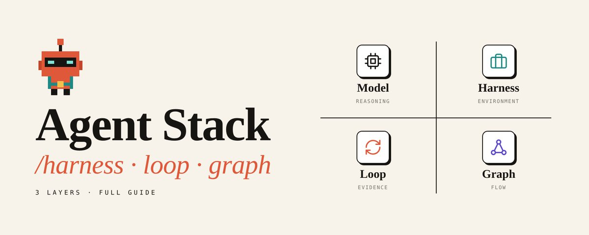

Your agent fails, so you rewrite the prompt. It fails again, so you switch the model. It fails a third time, so you add "IMPORTANT" in caps and hope for the best. Most people have been stuck in this cycle for a year now.

The problem is almost never the prompt, and most of the time it isn't the model either. The problem is the system around the model. In 2026 that system finally got names: harness, loop and graph.

People use these three words like they mean the same thing. They don't. Each one fixes a different kind of failure, and if you fix the wrong one you can burn a week debugging a layer that was fine all along.

This is the full breakdown: what each layer is, what it fixes, what breaks next, and how to tell which one your agent is missing. Bookmark it, you'll want the checklist later.

## The 30-Second Version

The harness gives the model hands, memory and walls. The loop gives it a check that can actually fail. The graph gives the work a shape, so the right step runs at the right time with the right inputs.

```
HARNESS   what the agent CAN do        environment
LOOP      how it knows it's RIGHT      evidence
GRAPH     what happens NEXT            flow
```

If you remember one line from this article, make it this one: environment, then feedback, then flow.

## Why This Suddenly Matters

At the end of last year Karpathy posted the most honest description of where we all are:

Read his list again: agents, subagents, prompts, contexts, memory, modes, permissions, tools, plugins, skills, hooks, MCP. That isn't one thing. It's three layers mashed into a single sentence.

Once you split them apart, "AI agents are unreliable" stops being a mystery and turns into a normal engineering problem with normal engineering fixes.

## Part 1. Harness

The harness is everything around the model that lets it do real work. The cleanest definition I know: remove the model from your architecture diagram, and everything still on the page is the harness.

 model in a repo with a terminal, tests, a browser, project memory and permissions, and it ships features. The weights didn't change. The harness did.

OpenAI ran into exactly this when they built a product with Codex and zero hand-written code. Early progress was slow, and it wasn't because the model was weak. The environment was underspecified. Their fix wasn't "try harder". They asked which capability was missing, then made it visible and enforceable for the agent.

Even Mitchell Hashimoto, the guy behind Terraform and Ghostty, says a generic agent harness beats every custom chat box he's tried:

### The 6 Parts of a Real Harness

1. Contract. Before the agent acts, turn the request into something with a finish line.

```
goal:        fix login redirect loop (#482)
inputs:      issue, repo, logs
output:      reviewable pull request
constraints: no schema changes, touch only auth/
done_when:   new test reproduces the bug
             same test passes after the fix
             full suite is green
```

The most important field here is done_when. Without it the agent will quietly solve an easier version of the task and tell you it's done.

2. Map. Don't dump every doc into the context window. Give the agent a short root file that tells it where things live, and let it load the details only when the task needs them.

```
AGENTS.md
-> architecture   docs/architecture.md
-> tests          docs/testing.md
-> security       docs/security.md
-> commands       docs/commands.md
```

Context isn't storage, it's an attention budget. A map saves it, a giant manual eats it before the agent writes a single line.

3. Tools. Every tool you add is one more way for the model to be wrong, so ten narrow tools beat forty overlapping ones. Each tool needs a clear input, a predictable output, an explicit failure state and a permission level.

```
READ FILES     allowed
RUN TESTS      allowed in sandbox
WRITE FILES    allowed in workspace
NETWORK        scoped by task
DEPLOY         needs approval
DELETE DATA    needs approval
```

4. Memory. The context window is RAM and the harness is the disk. Decisions, dead ends and open risks go into files and git commits, not into the chat.

```
PROGRESS.md
goal    fix #482 login redirect loop
tried   reorder auth middleware -> still red
known   only happens with expired session cookie
next    inspect auth/refresh.py
never   touch migrations/
```

This is how an agent survives a crash, a context reset or a handoff. The next session inherits the actual state of the work instead of a blurry summary of the conversation.

5. Walls. "Please don't touch migrations" is a wish. A permission the agent doesn't have is a wall. The model can suggest an action, but a policy outside the model decides whether it runs. Never let the same system invent the plan, approve the risk and execute the side effect.

6. Traces. Every run should leave a trail you can actually read: what context was loaded, which tools were called, what changed, which tests ran, how many retries, how much it cost. Without traces a failure is a mystery. With traces it's input for the next fix.

### The "Write It Twice" Trick

Most teams keep their important rules in prose. The agent reads them, follows them for a while, and then one day it ignores one. The fix is to write every important rule twice: once as guidance the agent can understand, and once as a check it can't get around.

```
GUIDE  (AGENTS.md, the agent reads it)
UI code may not query the database directly

CHECK  (CI, the agent can't argue with it)
lint fails if src/ui/** imports src/db/**
```

The guide explains the reason. The check holds even on the day the model ignores the guide. Over time this turns past mistakes into infrastructure, so the next agent doesn't have to remember the incident because the harness remembers it.

Anthropic now basically sells this whole layer as a product. The model reasons, the sandbox acts, and the session log survives if either one dies:

### What Breaks Next

With a decent harness your agent can work alone for an hour. Then it finishes with "Fixed! All tests should pass now." Notice the word "should". The harness made the agent capable, but nothing in the system makes it correct yet.

## Part 2. Loop

Every agent already has a tiny loop inside it: call the model, run a tool, feed the result back, repeat. Loop engineering starts when you design that cycle on purpose. Not "ask again", not "retry", but a real work-and-feedback system with a goal, evidence and a way to stop.

It went mainstream fast. Claude Code even shipped it as a command:

### Anatomy of a Loop

```
TRIGGER    what starts a cycle (failed test, new ticket, schedule)
GOAL       the exact condition we want, not "keep improving"
STATE      what the next cycle needs to know
ACTION     what the agent is allowed to do
EVIDENCE   how we know it worked
FEEDBACK   what exactly failed
STOP       when it ends, no matter what
```

The most important rule of loop engineering fits in one line: don't loop on confidence, loop on evidence. "The agent says it's done" is not a stop condition. Tests passing is.

### Not All Evidence Is Equal

```
STRONGEST    deterministic   tests exit 0, schema validates, build compiles
             observable      the trace shows it really ran the test
             independent     a reviewer in a separate context
WEAKEST      self-report     "looks good", "I'm confident", "should pass"
```

A check is only as strong as the weakest thing it accepts as proof. If your loop accepts "the model says it's done", it's a self-report loop no matter how many steps it has.

### Write the Check Before the Code

Before the agent touches a single file, write down what green means, and include a test that fails on the current code. A test that already passes before the fix proves nothing. There's a bonus here too: if you can't write the check, you don't actually understand the task yet. Writing the check is writing the spec.

### Feedback, Not Verdicts

"Red" is a verdict, and it tells the agent almost nothing. Real feedback says what was expected, what actually happened, where to look, and what has already been tried:

```
FAILED      test_expired_session_redirect
EXPECTED    302 -> /login
SAW         302 -> /dashboard  (auth/refresh.py:61)
FENCE       auth/refresh.py only
DEAD ENDS   middleware reorder
```

EXPECTED vs SAW turns a red light into a direction. DEAD ENDS stops attempt three from quietly turning back into attempt one.

### Exits

A loop without exits isn't persistence, it's a cost leak.

```
for attempt in range(3):
    artifact = build(state)
    evidence = verify(artifact)          # tests, not vibes

    if evidence.passed:
        return artifact
    if evidence.saw in state.dead_ends:  # same result twice
        break
    state.dead_ends.append(evidence.saw)
    state.repair = evidence.gap

return escalate_to_human(state)
```

The middle rule matters most. When the agent gets the exact same result twice, it has stopped learning from the loop and more attempts won't help. The missing piece is something it can't see, or the task was framed wrong. A loop can fix the work, but it can't fix the question.

Look at tip number five from the guy who built Claude Code. That's loop engineering in one sentence:

What Breaks Next

Now every individual step is great. But the real ticket was never one step. It was: fix the bug, check whether billing and admin use the same helper, and update the docs.

One agent does all of it in a line, inside one context. The second audit reads the first one's notes and just repeats them. The whole thing is slow, serial and holds one opinion, and on top of that the same agent grades its own work. No amount of loop tuning fixes this, because the problem isn't inside any step. It's between them.

## Part 3. Graph

In July one short question from Peter Steinberger got 3.1M views:

The timeline answered within hours:

What It Is

A graph is three things. Nodes are bounded jobs with one input and one output. Edges are real dependencies, where one node's output feeds another node's input. State is whatever survives between nodes.

```
NODE    one bounded job, one input in, one output out
EDGE    a real dependency, this output feeds that input
STATE   what survives between nodes
```

Here's the part that makes it click: a loop is just a graph with one node and an edge back to itself. The graph doesn't replace your loops. It's what you need once several loops have to hand work off to each other.

### The Early-Start Test

Most arrows in a workflow diagram aren't real dependencies. They're habits, just the order someone happened to think of the steps. So for every arrow, ask what would break if B started before A finished. If the answer is "nothing", delete the arrow and run them in parallel.

Can the billing audit start before the fix lands? Yes, so it runs in parallel. Can the PR open before the fix lands? No, so that arrow is real.

### 4 Cuts That Decide If a Graph Helps

Split where things fail separately. If two steps can break for different reasons, they're two nodes. If they always break together, they're one.

Give every worker its own context. Four agents sharing one context aren't a team, they're one agent wearing four hats. The first opinion written down becomes everyone's opinion.

If the answer should never change, it's code. Merging, sorting, deduping and counting are plain functions. Use a model only where a different answer could also be right.

Freeze what passed. Once a node gets through its gate, its output is read-only. When something fails, rerun only that node with its feedback. Rerunning good work is just a free chance to break it.

This is the real reason graphs exist, and Rohit put it well:

### When Not to Use a Graph

Most tasks don't need one. If you can collapse your five nodes back into a single loop and lose nothing, do it. And to be fair to the skeptics, LangGraph and Google ADK were doing nodes, edges and shared state long before the hashtag. The word is new, but the move from one loop to coordinated nodes is real. Just don't reach for it until the work forces you to.

## Where You Sit in All This

At level zero you are the whole system. Your hands run the code, your eyes check the result, and your head decides what happens next. The model is the only part that isn't doing the hard work.

The goal isn't an agent that never needs you. You're the slowest and most expensive node in the graph, so put yourself only where a mistake can't be taken back. Gate on the price of undo, not on the model's confidence:

```
ONE-CLICK UNDO   docs, tests, one function      ships on green
CLEANUP UNDO     shared helpers, auth, schemas  green + trace + second opinion
NO UNDO          migrations, deletes, emails, $ a human signs
```

The last tier has no score attached. Not 0.95, not 0.99. There's no number for the model to beat, so there's nothing to argue with.

## Which Layer Is Broken?

Before you change anything, find your first symptom from the top of this list. That's your next fix, not the one after it.

```
SYMPTOM                                         FIX THE
you copy-paste between chat and terminal        harness (tools)
it retries things it already tried              harness (memory)
"done" means nothing until you check            loop (the check)
retries burn budget on the same error           loop (feedback + exits)
every step is right, the whole thing is slow    graph (shape)
one failure means everything reruns             graph (gates)
the same mistake comes back every week          all layers (learning)
```

## Every Failure Should Upgrade the System

Most people fix the output. Good teams fix the class of failure, and the trick is filing each lesson in the layer that owns it.

```
FAILURE                               LESSON BECOMES               LAYER
couldn't see production logs          read-only log tool           harness
retried last week's dead approach     line in the "never" list     harness
touched a file it shouldn't           permission it no longer has  harness
"fixed" with no reproducing test      required check in CI         loop
same error 6 times in a row           same-result-twice exit       loop
two audits overlapped                 split rule in scope node     graph
typo and auth change got same review  undo-price gate              graph
```

Notice there's no "prompt" row. "Be careful not to duplicate work" in a prompt is a hope, while a split rule in the scheduler is structure. Next quarter's model will read your prompt differently, but a test reads the same way forever.

## 5 Mistakes That Kill Agent Systems

1. Building the graph too early. People draw a twelve-node diagram before they've watched the agent do the job once. Start with a harness and one loop, collect traces, and formalize only what actually deserves it.

2. The same model writes and grades. Self-review shares the same blind spots as the original work. Use tests first, a reviewer in a separate context second, and a human for anything you can't undo.

3. "Keep trying" as a loop. That isn't a loop, it's an open tab on your credit card. Every loop needs a goal, real evidence, a retry cap and an exit.

4. The harness as a junk drawer. More tools don't make a better agent, they make more wrong choices. A good harness isn't crowded, it's precise.

5. Blaming the model. No model can compensate for broken APIs, stale state, vague tool schemas or missing exits. Fix the layer that owns the failure.

## The Checklist

### Harness

- Success is defined before the run starts
- The root guide is a map, not a manual
- Every tool has a clear contract and failure state
- Decisions live in files, not in the chat
- The agent runs in a sandbox or worktree
- Every tool call is traced

### Loop

- Green is written before the code
- The check fails at least once on purpose
- Feedback says expected vs saw
- There's a retry cap and a token budget
- Same result twice means escalate

### Graph

- You tried to keep it a single loop first
- Every arrow passed the early-start test
- Each worker has its own context
- Passed nodes are frozen
- Gates are priced by undo, not confidence

If several of these are a no, a smarter model won't save you. It'll just make the failure faster and more expensive.

## The Real Shift

Prompt engineering tells the model what to do. Context engineering decides what it sees. Harness engineering builds the world it acts in. Loop engineering makes it prove its work. Graph engineering decides who does what next.

```
PROMPT    -> instruction
CONTEXT   -> working view
HARNESS   -> environment
LOOP      -> evidence
GRAPH     -> coordination
```

Models will keep changing every quarter. Your contracts, tools, tests, state files and gates stay, and they get better with every failure you file in the right place. That's where the real advantage lives now.

The harness makes the agent capable. The loop makes it honest. The graph makes it organized.

Next time your agent says "done", ask which layer said so.

## If You Read This Far

Bookmark this so you have the checklist the next time you build an agent.

Follow @0xWhitemon for more breakdowns like this.

And send it to the one friend who still fixes every agent bug with a longer prompt.

<!-- x2doc:source -->

> 原文链接：[查看原文](https://x.com/0xWhitemon/status/2119430401701621865)
> 抓取时间：2026-11-09T23:38:22.165024+08:00
